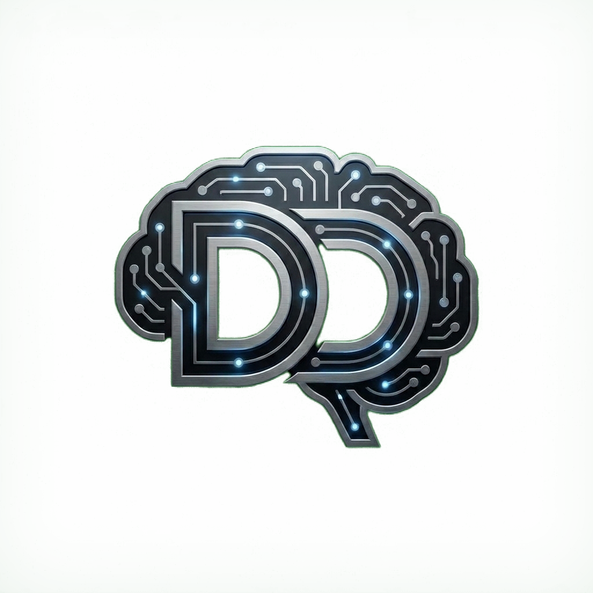

# Yerel AI Stüdyosu

<p align="center">
  
</p>

<p align="center">
  <strong>Türkçe öncelikli, tamamen kendi bilgisayarınızda çalışan yapay zekâ stüdyosu.</strong><br/>
  Sohbet asistanı Vega · konuşma tanıma · doğal Türkçe seslendirme · görsel, müzik ve video üretimi — tek pencereden.
</p>

<p align="center">
  
  
  
</p>

> Bu proje, **DD:YZ "Sansürsüz Lokal AI Stüdyosu"** (V1/V2, Tech Jarves / DD:YZ, MIT) temel alınarak bağımsız bir depoda geliştirilmektedir.
> Asıl sahip ve ana geliştirici **DD:YZ (Tech Jarves)**'tir; orijinal emek ve MIT lisansı korunur. **Bu çatal [leaykan](https://github.com/leaykan) ve Claude (Anthropic) tarafından geliştirildi.**
> Ayrıntılar [Geliştiriciler ve atıflar](#atif) bölümünde.

**Tek başına çalışır.** Kurmak ve kullanmak için hiçbir yapay zekâ asistanı, hesap, abonelik ya da ek program gerekmez:
`Kurulum.bat`'ı çalıştırın, sihirbazda "İleri" deyin. Sohbet, ses ve görsel modelleri internetten bir kez indirildikten sonra
uygulama internetsiz de çalışır.

*English summary: [below](#english).*

---

## İçindekiler

- [Neler yapabilir?](#ozellikler)
- [Donanım gereksinimleri ve gerçek süreler](#donanim)
- [Kurulum](#kurulum)
- [İlk kurulum sihirbazı](#sihirbaz)
- [Kullanım](#kullanim)
- [Gizlilik](#gizlilik)
- [Güvenlik notları](#guvenlik)
- [Geliştiriciler için](#gelistirici)
- [Geliştiriciler, atıflar ve lisans](#atif)
- [English](#english)

---

## <a id="ozellikler"></a>Neler yapabilir?

**Vega ile sohbet** — llama.cpp üzerinde yerel dil modelleri (önerilen: Gemma 4 E4B). Vega gerektiğinde araç kullanır:
web araması (siz açtığınızda; haberlerde Google Haberler + DuckDuckGo), hesap makinesi, saat/tarih. Sohbetten doğrudan görsel,
müzik, ses efekti ve video üretimi isteyebilirsiniz. Sesli sohbet: konuşun, yazıya dökülsün; yanıtlar otomatik okunsun
(kapatılabilir), "eller serbest" modu, her yanıtın yanında tekrar okuma düğmesi.

**Görsel Stüdyo** — stable-diffusion.cpp ile SD 1.5, SDXL ve Lightning modelleri (`.safetensors`, `.gguf`).
Ayarlar seçili modele göre kendiliğinden gelir; ekran kartı olmayan bilgisayarlar için **hızlı mod** (LCM / Hyper-SD, 4–8 adım),
RealESRGAN ile büyütme, img2img.

**Sesten metne (STT)** — Whisper (whisper.cpp; varsayılan *small q5_1*, çok dilli), Türkçeye özel **Seda** ve **Duyu**.

**Metinden sese (TTS)** — **EMA Lightning** (doğal ve doğru telaffuzlu Türkçe), **Antalia-2 Mini**, **Supertonic-3** (10 ses),
**Ahenk Cep** (7 ruh hali), **OmniVoice** (ses klonlama; ekran kartı önerilir, ticari olmayan lisans), **Piper**, **Kokoro** (İngilizce).

**Müzik ve Ses Efekti Stüdyosu** — MusicGen Small ile kısa müzik, AudioLDM-S ile ses efekti.

**Video Stüdyosu** — AnimateDiff (kendi SD 1.5 modelinizle) ve Wan 2.1 1.3B. Ekran kartı önerilir.

**Kullanıcılar ve kişisel hafıza** — uygulama ilk açılışta bir **yönetici hesabı** oluşturmanızı ister; yönetici başka kullanıcılar
ekler, siler ve şifrelerini sıfırlar. Her kullanıcının sohbet geçmişi, üretimleri (görsel, müzik, video, ses) ve kişisel hafızası
ayrıdır. Vega, sohbetlerden kısa notlar tutarak sizi tanır (adınız, hitap şekliniz, tercihleriniz, projeleriniz); "bunu unutma"
dediğiniz bilgiyi anında not eder. Notları Ayarlar'dan görür, düzeltir, silersiniz. Her açılışta ve 15 dakika hareketsizlikten sonra
şifre istenir. Hepsi yalnızca bu bilgisayarda kalır.

**Bulut modelleri (isteğe bağlı)** — OpenAI, Gemini, Anthropic ya da OpenRouter modellerini **kendi API anahtarınızla** ekleyebilirsiniz.
Anahtar yalnızca sizin bilgisayarınızda şifreli saklanır; Vega kendiliğinden buluta geçmez, bulut modelleri açıkça etiketlidir.

**Otomasyon kuyruğu (isteğe bağlı, gelişmiş)** — `app/is-kuyrugu/bekleyen/` klasörüne bırakılan JSON iş dosyalarıyla tarayıcısız
görsel üretimi (kendi betikleriniz ya da Windows Görev Zamanlayıcı için). Normal kullanımda hiçbir şey yapmanız gerekmez ve hiçbir harici
araca bağlı değildir; klasöre dosya yazan bir şey yoksa kuyruk boşta bekler. Belge: [`app/is-kuyrugu/BENIOKU.md`](app/is-kuyrugu/BENIOKU.md).

**Taşınabilir** — Node.js, Python ve motorlar uygulama klasörüne kurulur; bilgisayara bir şey kurulmaz, yönetici izni gerekmez.
USB belleğe kurulup başka bir Windows bilgisayarda çalıştırılabilir.

Arayüzün tamamı Türkçedir.

---

## <a id="donanim"></a>Donanım gereksinimleri ve gerçek süreler

| | En az | Önerilen |
|---|---|---|
| İşletim sistemi | Windows 10/11, 64 bit | Windows 11 |
| Bellek (RAM) | 8 GB (küçük sohbet modeli) | 16 GB |
| Disk | ~3 GB (uygulama + motorlar) + modeller | 25 GB+ boş alan (denenmiş model setinin tamamı ~13 GB) |
| Ekran kartı | Gerekmez (yalnızca işlemciyle çalışır, ama yavaştır) | Görsel ve özellikle **video** için NVIDIA (8 GB+ VRAM) |
| İnternet | Kurulum ve model indirme için | — |

**Ekran kartı olmadan gerçek süreler** (Intel i5-7200U, 16 GB RAM, tümleşik Intel HD 620 — yani ekran kartı belleği yok):

| İş | Süre |
|---|---|
| Gemma 4 E4B (Q4_K_M) modelini yükleme | ~10–16 sn |
| Konuşma tanıma (Seda), kısa bir cümle | ~2 sn |
| Görsel, SD 1.5, 512×512, 20 adım | ~10 dk |
| Görsel, SD 1.5 hızlı mod (Hyper-SD 8 adım) | ~3 dk |
| Görsel, SDXL Lightning, 1024×1024, 4 adım | ~19,5 dk |
| Müzik, MusicGen Small, 15 saniyelik parça | ~6 dk |
| Video, en düşük ayarlar, **1 saniyelik** klip | ~22 dk |
| Video, Wan 2.1 1.3B | Önerilmez (bellek yetmeyebilir) |

Kısacası: ekran kartı olmayan bir bilgisayarda sohbet ve ses rahat çalışır; görsel dakikalar, video ise saniye başına onlarca dakika sürer.

Tümleşik ekran kartlarının "paylaşımlı belleği" gerçek ekran kartı belleği (VRAM) değildir ve hız kazandırmaz; sihirbaz bu yüzden
böyle bilgisayarları "işlemci ile çalışma" sınıfında değerlendirir. Ayrık bir ekran kartıyla görsel süreleri saniyeler mertebesine iner.

---

## <a id="kurulum"></a>Kurulum

### Windows (önerilen): `Kurulum.bat`

1. Bu deponun [Releases](../../releases/latest) (Sürümler) sayfasından **`Kurulum.bat`** dosyasını indirin ve çift tıklayın.
   - Windows "Windows kişisel bilgisayarınızı korudu" uyarısı gösterebilir (dosya imzasız olduğu için). **Ek bilgi → Yine de çalıştır**.
     İsterseniz önce dosyayı Not Defteri'yle açıp okuyabilirsiniz; tek bir metin dosyasıdır.
2. Kurulum son sürümü GitHub'dan indirir ve **SHA256 özetini** sürümdeki `SHA256SUMS.txt` ile doğrular. Özet bulunamazsa ya da uyuşmazsa
   kurulum durur (doğrulanmamış paketle devam etmek için açıkça "E" demeniz gerekir; varsayılan "Hayır"dır).
3. Nereye kurulacağını seçin:
   - **[1] Bu bilgisayara (önerilen)** — kendi kullanıcı klasörünüze: `%USERPROFILE%\YerelAIStudyosu` (ör. `C:\Users\<kullanıcı adı>\YerelAIStudyosu`).
     Klasör adını değiştirebilirsiniz; klasör yoksa oluşturulur. Windows'ta geçersiz adlar (`CON`, `NUL`, `\ / : * ? " < > |` içeren adlar vb.) kabul edilmez.
     Kullanıcı adınızda Türkçe harf varsa (ör. `ö`, `ş`) bazı motorlar bu yolda sorun çıkarabileceği için `C:\YerelAIStudyosu` önerilir.
     Masaüstüne kısayol eklenir.
   - **[2] USB / taşınabilir sürücüye** — takılı USB bellek ve harici diskler boş alanlarıyla listelenir; klasör adını yine siz verirsiniz.
     FAT32 biçimli sürücülerde tek dosya 4 GB'ı geçemez (Gemma 4 E4B ~5 GB, SDXL modelleri ~7 GB); sürücüyü **exFAT** ya da **NTFS** yapmanız önerilir.
     USB 3 bellek ya da harici SSD kullanın.
   - **[3] Başka bir klasöre** — tam yolunu yazarsınız (ör. `D:\YerelAIStudyosu`). Yönetici izni isteyen yerler (ör. Program Files) kullanılamaz.
4. Paket seçilen klasöre açılır ve `windows.bat` başlatılır. İlk açılışta `windows.bat` taşınabilir Node.js'i ve yapay zekâ motorlarını
   (llama.cpp, stable-diffusion.cpp, whisper.cpp, Kokoro) indirir (~1–1,5 GB, bir kerelik). Ardından tarayıcıda uygulama ve **ilk kurulum sihirbazı** açılır;
   sihirbazda “İleri” diyerek denenmiş model setini kurabilirsiniz. Kurulum için hiçbir ek program, hesap ya da yapay zekâ asistanı gerekmez.

Sonraki açılışlarda masaüstü kısayolunu ya da klasördeki `windows.bat`'ı kullanın.

**Güncelleme:** `Kurulum.bat`'ı yeniden çalıştırıp aynı klasörü seçin. Kurulum mevcut kurulumu tanır, kurulu ve yeni sürümü gösterir;
program dosyaları yenilenir, **modelleriniz, sohbet geçmişiniz ve ayarlarınız korunur**. Güncellemeden önce uygulamayı kapatın.

### İnternetsiz / yerel paketle kurulum

`Kurulum.bat`, **yanında** bir sürüm paketi (`YerelAIStudyosu-<sürüm>.zip`) ve `SHA256SUMS.txt` bulursa paketi indirmek yerine onu kurar
(önce sorar; varsayılan "Evet"). Ekranda **"Yerel paketten kuruluyor"** yazar ve zip yine `SHA256SUMS.txt` ile doğrulanır. Paketin yolunu ilk argüman olarak da verebilirsiniz;
zip dosyasını `Kurulum.bat`'ın üzerine sürükleyip bırakmak aynı işi yapar:

```bat
Kurulum.bat "<zip dosyasının tam yolu>"
```

USB bellekten kurulum ya da internetin olmadığı bir bilgisayar için sürümdeki üç dosyayı (`Kurulum.bat`, zip, `SHA256SUMS.txt`) aynı klasöre koymanız yeterlidir.

### Sürümü GitHub'a koymadan denemek (geliştiriciler)

```bash
# Çalışma kopyasından temiz kopya + yerel deneme paketi üret (çalışma kopyası değişmez)
node scripts/yayin/disa-aktar.cjs ../YerelAIStudyosu-yayin --paket ../YerelAIStudyosu-paket --surum 1.0.0 --deneme
```

`../YerelAIStudyosu-paket` klasöründe `YerelAIStudyosu-1.0.0.zip`, `SHA256SUMS.txt` ve `Kurulum.bat` oluşur. Oradaki `Kurulum.bat`'ı çift tıklayın:
paket internetten değil bu klasörden kurulur. Deneme paketi GitHub'a yüklenmez (yayın paketi için [Sürüm yayımlama](#gelistirici)).
Deneme kurulumunu çalışan geliştirme kopyasından ayrı bir klasöre yapın ve aynı anda iki kopyayı çalıştırmayın (aynı bağlantı noktasını kullanırlar).

### Windows: elle

Sürümdeki `YerelAIStudyosu-*.zip` dosyasını indirip bir klasöre açın (ya da `git clone`) ve `windows.bat`'ı çift tıklayın.

### Linux ve macOS (deneysel)

```bash
./linux.sh   # ya da ./mac.sh
```

Temel özellikler (sohbet, görsel, Whisper, Kokoro) çalışır. EMA ve diğer Python tabanlı Türkçe ses motorlarının otomatik kurulumu
şimdilik yalnızca Windows'ta yapılır; bu sistemlerde Python 3.11+ kurup motorları elle kurmanız gerekir. Bu sürümler Windows kadar denenmedi.

### Kaldırma

Uygulama klasörünü ve masaüstü kısayolunu silin. Başka bir yere bir şey yazılmaz.

---

## <a id="sihirbaz"></a>İlk kurulum sihirbazı

Uygulama ilk açıldığında önce **yönetici hesabı** oluşturulur (kullanıcı adı + şifre; bu ilk kullanıcı yöneticidir).
Ardından sihirbaz bir kez görünür (istediğiniz zaman **Ayarlar › "İlk kurulum sihirbazını yeniden aç"**):

1. **Bilgisayarınız** — işlemci, bellek, ekran kartı (tümleşik mi ayrık mı) ve boş disk. Tümleşik ekran kartının paylaşımlı belleği VRAM sayılmaz.
2. **Önerilen modeller** — her bölümde **denenmiş varsayılan set önceden seçili** gelir; alternatifler altında, seçilmemiş olarak listelenir.
   Model seçmeyi bilmiyorsanız “İleri — indir ve kur” demeniz yeterli. Her kartta boyut, lisans ve o bilgisayara özel
   “Bu bilgisayarda” notu yazar; toplam indirme ve boş disk gösterilir. Güçlü bilgisayarda büyük alternatifler
   “güçlü bilgisayarınız için” diye işaretlenir ama varsayılan seçim değişmez.

   | Bölüm | Denenmiş varsayılan | Alternatifler |
   |---|---|---|
   | Sohbet | **Gemma 4 E4B Q4_K_M** (~4,6 GB) | Gemma 4 E2B (8 GB bellek için) |
   | Sesten metne | **Whisper small q5_1** (~180 MB) | Seda, Duyu (Türkçeye özel); Whisper base / medium / large-v3 turbo |
   | Metinden sese | **EMA Lightning** (Türkçe; Windows) | Antalia-2 Mini, Supertonic-3, Ahenk Cep, Piper, Kokoro (İngilizce); OmniVoice (ağır) |
   | Görsel | **CyberRealistic V8** (SD 1.5, ~2 GB) | Juggernaut XL v9 Lightning, DreamShaper 8, DreamShaper XL Lightning |
   | Müzik | **MusicGen Small** (~2,4 GB) | — |
   | Ses efekti | **AudioLDM-S Full v2** (~1,7 GB) | — |
   | Video | **AnimateDiff v1.5 v2** (~1,8 GB, CyberRealistic'i taban alır) | Wan 2.1 1.3B (~29 GB; güçlü ekran kartı için) |

   Denenmiş setin tamamı ~13 GB'tır (Python + PyTorch ortamı bir kez dahil). Tek dosyalı modeller Hugging Face'te sabit bir
   sürümden (commit) iner ve SHA256 özetiyle doğrulanır; çok dosyalı paketler sabit sürümden dosya özetleriyle doğrulanır.
3. **Kurulum** — seçilenler sırayla iner; sihirbazı kapatsanız da indirme arka planda sürer.
4. **Yapay zekânız** — asistanın adı (isteğe bağlı) ve önerilen sistem mesajı.
5. **İsteğe bağlı** — bulut modelleri ve Model Yöneticisi.

Sihirbaz atlanabilir; her şey sonradan Model Yöneticisi'nden indirilebilir.

---

## <a id="kullanim"></a>Kullanım

- **Sohbet**: üstteki model seçiciden modeli yükleyin, Vega'ya yazın ya da mikrofona basıp konuşun. "Web" düğmesi açıkken Vega gerektiğinde arama yapar.
  Vega'nın sistem mesajını Ayarlar › Metin bölümünden değiştirebilirsiniz.
- **Görsel**: "Bir uzay istasyonu çiz" gibi isteklerde Vega model seçtirir ve görseli sohbete getirir; ayrıntılı ayarlar için Görsel Stüdyo.
- **Müzik / Video**: ilgili stüdyo sayfasındaki düğmeyle modelleri kurun; donanımınız yetersizse sayfa uyarır.
- **Modeller**: Model Yöneticisi'nden indirin, içe aktarın, silin. Bilgisayarınıza uygunluk notları kartlarda yazar.

---

## <a id="gizlilik"></a>Gizlilik

- Tüm yapay zekâ işlemleri bilgisayarınızda yapılır. Telemetri ya da çevrimiçi hesap yoktur; kullanıcı hesapları yalnızca bu bilgisayarda tutulur
  (şifreler scrypt ile özetlenir, düz metin saklanmaz).
- İnternet yalnızca şunlar için kullanılır: kurulum ve model indirme; siz açtığınızda web araması; siz eklediğinizde bulut modelleri
  (o durumda mesajlarınız seçtiğiniz sağlayıcıya gider).
- Sohbet geçmişi, kişisel hafıza, üretilen dosyalar, ayarlar ve anahtarlar uygulama klasöründe kalır (`app/kullanicilar`, `app/outputs`, `app/config`).
  Bu klasörler depoya girmez ve dışa aktarma betiği tarafından asla kopyalanmaz.
- Ses klonlama örnekleri yalnızca sizin bilgisayarınızda saklanır; başkasının sesini yalnızca açık izniyle kullanın.
- Kişisel hafıza bulut modellerine varsayılan olarak gönderilmez (Ayarlar'dan açılabilir).
- Şifrenizi unutursanız yönetici sıfırlar. Yönetici şifresi unutulursa `app/kullanicilar` klasörü silinerek sıfırlanabilir
  (tüm hesaplar, sohbet arşivleri ve hafızalar da silinir; önce yedekleyin).

---

## <a id="guvenlik"></a>Güvenlik notları

- Sunucu yalnızca **yerel** isteklere yanıt verir; başka sitelerden gelen istekler ve çerçeve içine gömme reddedilir.
  Uygulamayı ağa / internete açmayın (uzaktan erişim için parola, HTTPS ve VPN gerekir; bu sürümde yoktur).
- Sohbetler ve kişisel hafıza diskte, kullanıcının şifresinden türetilen anahtarla şifrelidir (scrypt + AES-256-GCM); şifre bilinmeden
  okunamaz. Ses klonu kayıtları ve sesli sohbet örnekleri de sahibinin anahtarıyla şifrelidir; ses motoru için açık kopya yalnızca
  kullanım anında bu bilgisayarın geçici klasörüne yazılır, çıkışta ve kapanışta silinir. Üretilen görsel/ses/video dosyaları
  şifrelenmez; yalnızca sahibine erişim izni verilir.
  Uygulama klasörünü taşınabilir diskte taşıyorsanız bunu göz önünde bulundurun (gerekirse Windows BitLocker To Go kullanın).
- Ses klonları kullanıcıya özeldir. Sistem ayarlarını etkileyen işlemler (bulut anahtarları, model indirme/silme, temizlik, kurulum,
  güncelleme) yalnızca yöneticiye açıktır.
- Kullanıcı oluşturulduktan sonra sunucu uç noktaları oturum ister; oturum çerezi HttpOnly + SameSite=Strict'tir, uygulama her açılışta
  yeniden giriş ister. Hatalı girişler sınırlanır. Bir kullanıcının üretim dosyalarını başka bir kullanıcı göremez, indiremez, silemez.
- Bulut API anahtarları uygulamaya gömülü değildir; Windows'ta DPAPI ile şifrelenir, arayüze maskeli döner, Gemini anahtarı adres satırında değil başlıkta gönderilir.
- Model ve motor indirmeleri yalnızca `https://` üzerinden yapılır. Python paketleri sabit sürümlerle ve yalnızca hazır paket (wheel) olarak kurulur;
  bazı motorlar özet (hash) doğrulamalıdır. Kurulum dosyası sürüm paketini SHA256 ile doğrular.
- `.safetensors` ve `.gguf` dışındaki model biçimleri (ör. `.ckpt`, pickle) kod çalıştırabilir; yalnızca güvendiğiniz kaynaklardan indirin.
- "Sansürsüz" işaretli modeller yetişkin içerik üretebilir. Model Yöneticisi bu modelleri etiketler; çocukların kullandığı bilgisayarlarda dikkatli olun.
- Otomasyon kuyruğu klasörüne yazabilen her program görsel ya da indirme işi ekleyebilir; uygulama klasörünü paylaşımlı/ağ sürücüsüne koymayın.
- Güvenlik açığı bulursanız lütfen herkese açık bir issue yerine depo sahibine özel olarak bildirin (GitHub › Security › Report a vulnerability).

---

## <a id="gelistirici"></a>Geliştiriciler için

- `windows-dev.bat` — arayüzü canlı yenilemeyle çalıştırır (Vite, port 1420; sunucu 1422).
- `windows.bat` — arayüz kaynakları derlemeden yeniyse açılışta kendiliğinden yeniden derler.
- Sunucu: `scripts/server/serve.cjs` (+ `bulut.cjs`, `ozellikler.cjs`, `studyo.cjs`); arayüz: `app/frontend` (React + Vite); işçiler: `scripts/workers`.
- İlk kurulum sihirbazı: `app/frontend/src/components/IlkKurulumSihirbazi.jsx` + `scripts/setup/ilk-kurulum-sunucu.cjs`.

### Sürüm yayımlama

```bash
# Çalışma kopyasından temiz bir kopya + sürüm paketi üret (çalışma kopyası değişmez)
node scripts/yayin/disa-aktar.cjs ../YerelAIStudyosu-yayin --paket ../surum --surum 1.0.0 --depo <sahip>/YerelAIStudyosu
```

GitHub deposu tek yerde tanımlıdır: `Kurulum.bat`'ın başındaki `$Repo` satırı. Çalışma kopyasında bu satırdaki sahip adı
`HESAP` yer tutucusu olabilir; yer tutucu dururken betik yayın paketi üretmez (yalnızca `--deneme` ile yerel deneme paketi).
`--depo` verilirse yer tutucu yalnızca dışa aktarılan kopyadaki `Kurulum.bat`'ta doldurulur. README depo adını içermez;
sürüm sayfasına göreli bağlantıyla (`../../releases/latest`) gider, böylece depo adı değişse de README değişmez.

Betik yalnızca izin listesindeki dosyaları kopyalar (modeller, motorlar, sohbet geçmişi, çıktılar, günlükler, `app/config`, ses klonu kayıtları,
yedekler ve geliştirici not klasörleri dışarıda kalır), geliştiriciye özgü varsayılanları genelleştirir ve sonucu anahtar/jeton, kişisel yol,
e-posta, kişisel ad, kopyalanmış kişisel veri dosyası ve yapay zekâ asistanına özgü kalıntı için tarar. Bulgu varsa durur ve zip üretmez.
Dosya ve klasör adları da taranır. Kişisel adlar betiğin içine yazılmaz; **çalışma anında** verilir ve yayın paketi için en az bir ad
bulunması zorunludur (yoksa betik durur):

```bash
node scripts/yayin/disa-aktar.cjs ../YerelAIStudyosu-yayin --paket ../surum --surum 1.0.0 --depo <sahip>/YerelAIStudyosu \
  --isimler-dosyasi ../ozel-isimler.txt      # proje dışındaki dosya: her satıra bir ad ("Ad Soyad", kullanıcı adı, e-posta öneki)
# ya da: --isim "Ad Soyad" --isim kullaniciadi   ·   YAS_OZEL_ISIMLER="Ad Soyad;kullaniciadi"   ·   scripts/yayin/ozel-isimler.txt (git'e girmez)
```

Tam adlardan kullanıcı adı biçimleri (adsoyad, ad.soyad, baş harfler + soyad…) ve Türkçe harfsiz yazımlar kendiliğinden türetilir.
Bunlara ek olarak betik bu bilgisayardaki işletim sistemi kullanıcı adını, git `user.name`/`user.email`'i ve ses klonu onay kayıtlarındaki adı da tarar.

GitHub sürümüne üç dosya eklenir: `YerelAIStudyosu-<sürüm>.zip`, `SHA256SUMS.txt` ve `Kurulum.bat`.
Kendi deposunda yayımlayanlar `Kurulum.bat`'ın başındaki `$Repo` satırını kendi depolarına çevirir.

---

## <a id="atif"></a>Geliştiriciler, atıflar ve lisans

### Geliştiriciler
- **DD:YZ (Tech Jarves)** — asıl sahip ve ana geliştirici (orijinal proje).
- **[leaykan](https://github.com/leaykan)** — bu çatalın geliştiricisi (fikir, yön, test).
- **Claude (Anthropic)** — bu çatalın geliştiricisi (kod).

### Atıflar
- **Temel proje:** [DD:YZ — Sansürsüz Lokal AI Stüdyosu](https://github.com/DDYapayZeka/SansursuzLokalAIStudyosu-DDYZ)
  ve [V2](https://github.com/DDYapayZeka/SansursuzLokalAIStudyosu-V2) (Tech Jarves / DD:YZ, MIT). Müzik, video, Seda/Duyu ve bulut
  yaklaşımı V2'den uyarlanmıştır. Bu emeğe teşekkür ederiz; buradaki geliştirmeleri orijinal geliştirici dilediği gibi kullanabilir.
- **Lisans:** [MIT](LICENSE). Yalnızca orijinal telif satırı (Tech Jarves) korunur.
- **Modeller ve bileşenler:** depoyla dağıtılmaz, ayrıca indirilir ve her biri kendi lisansına tabidir. Bazıları (MusicGen, AudioLDM-S,
  OmniVoice) **yalnızca ticari olmayan** kullanıma izin verir. Tam liste: [ATIFLAR.md](ATIFLAR.md).
- Değişiklik günlüğü (V2'ye göre): [DEGISIKLIKLER.md](DEGISIKLIKLER.md).

---

## <a id="english"></a>English

**Yerel AI Stüdyosu** ("Local AI Studio") is a Turkish-first, fully local AI studio for Windows 10/11 (Linux/macOS experimental).
It is based on DD:YZ's MIT-licensed *Sansürsüz Lokal AI Stüdyosu* (V1/V2, Tech Jarves / DD:YZ); this fork was **developed by [leaykan](https://github.com/leaykan) and Claude (Anthropic)**. DD:YZ (Tech Jarves) remains the original owner and main developer.
It is a standalone application: installing and using it requires no AI assistant, account or subscription.

- **Chat assistant "Vega"** on llama.cpp (recommended: Gemma 4 E4B) with tool use (web search when enabled, calculator, clock) and voice chat.
- **Image studio** (stable-diffusion.cpp: SD 1.5 / SDXL / Lightning, fast LCM/Hyper-SD mode, upscaling), **speech-to-text** (Whisper, Seda, Duyu),
  **text-to-speech** (EMA Lightning, Antalia, Supertonic, Ahenk, OmniVoice, Piper, Kokoro), **music & SFX** (MusicGen Small, AudioLDM-S),
  **video** (AnimateDiff, Wan 2.1 1.3B; GPU recommended), optional **cloud models with your own API key**, and an optional file-based **automation queue**.
- **Install:** download `Kurulum.bat` from Releases and run it. It installs to `%USERPROFILE%\YerelAIStudyosu`, another folder or a USB drive
  (warns about FAT32's 4 GB file limit), verifies the release zip against `SHA256SUMS.txt`, and starts the app. No AI assistant, account or extra
  software is needed. The first-run wizard pre-selects a tested model set (Gemma 4 E4B, Whisper small q5_1, EMA Turkish TTS, CyberRealistic V8,
  MusicGen Small, AudioLDM-S, AnimateDiff; ~13 GB) with alternatives listed below it, per-model hardware notes (integrated-GPU shared memory
  is not counted as VRAM) and pinned, SHA256-verified downloads.
- **CPU-only reality check** (i5-7200U, 16 GB, no discrete GPU): it works, but slowly. Gemma 4 E4B loads in ~10–16 s, a short sentence is
  transcribed in ~2 s, an SD 1.5 image takes ~10 min (~3 min in fast mode), 15 s of MusicGen Small music ≈ 6 min, and **1 second of video at minimum
  settings ≈ 22 min**. A GPU is recommended for images and especially video.
- **Local users & personal memory:** an administrator account is created on first launch; each user has separate chats, outputs and a personal memory (Vega remembers your name, how to address you, preferences; notes are editable). Login is required on every start and after 15 minutes of inactivity.
- **Privacy:** everything runs locally; no telemetry or online accounts. The internet is used only for downloads, web search you enable, and cloud models you add.
- **Developers:** DD:YZ (Tech Jarves), original owner and main developer; this fork developed by leaykan and Claude (Anthropic).
- **License:** MIT (only the original copyright line is kept). Models are downloaded separately under their own licenses; some are non-commercial — see `ATIFLAR.md`.
